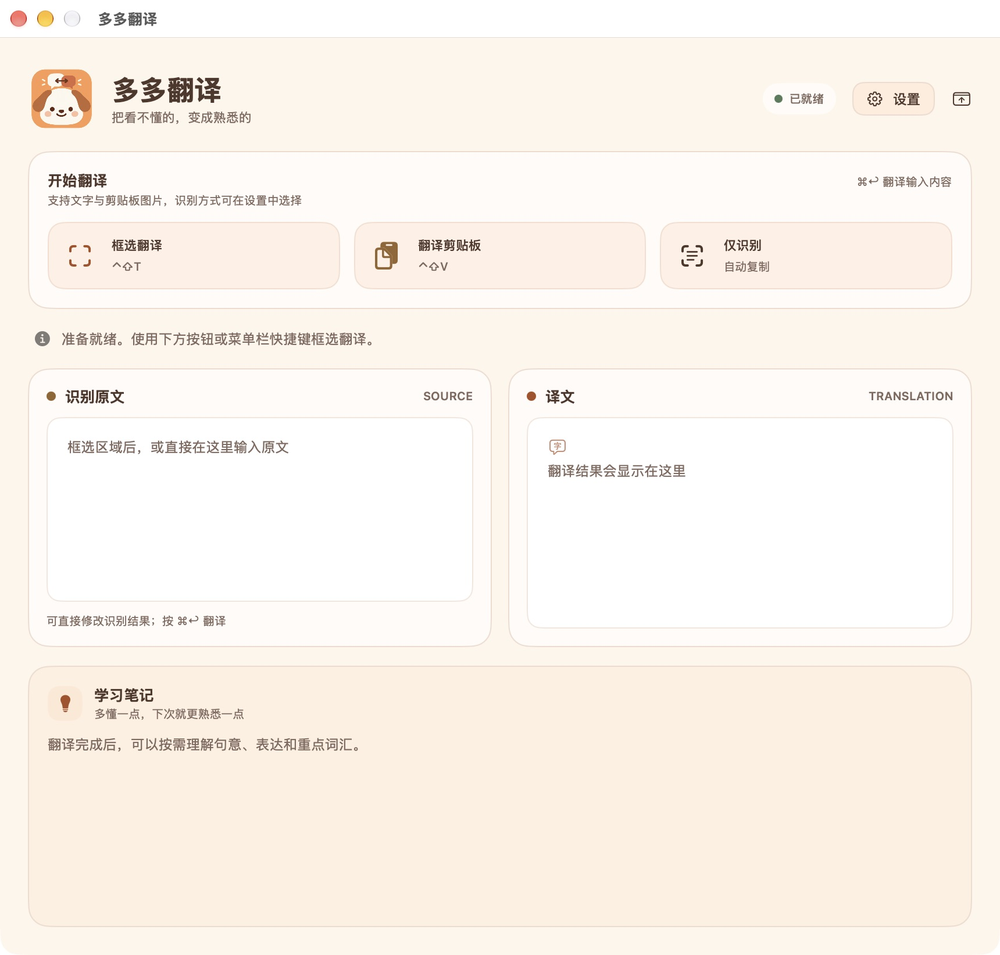
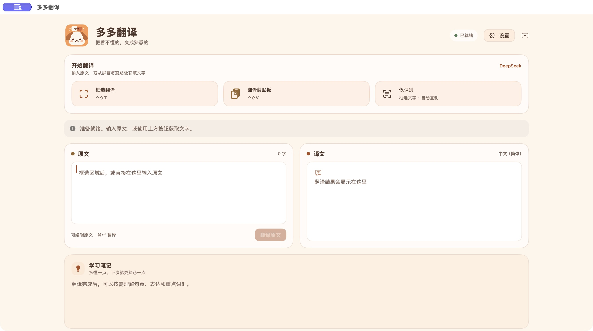
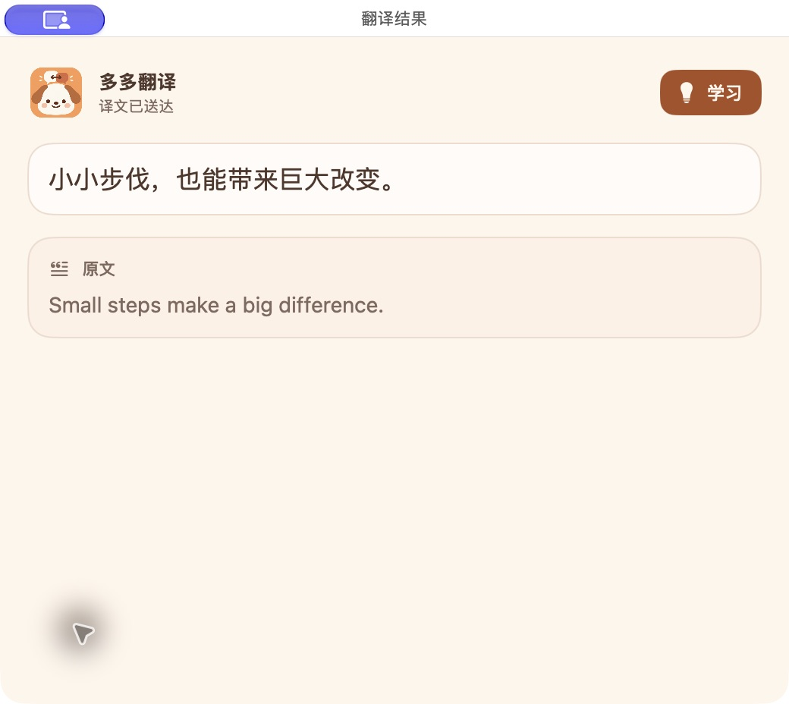
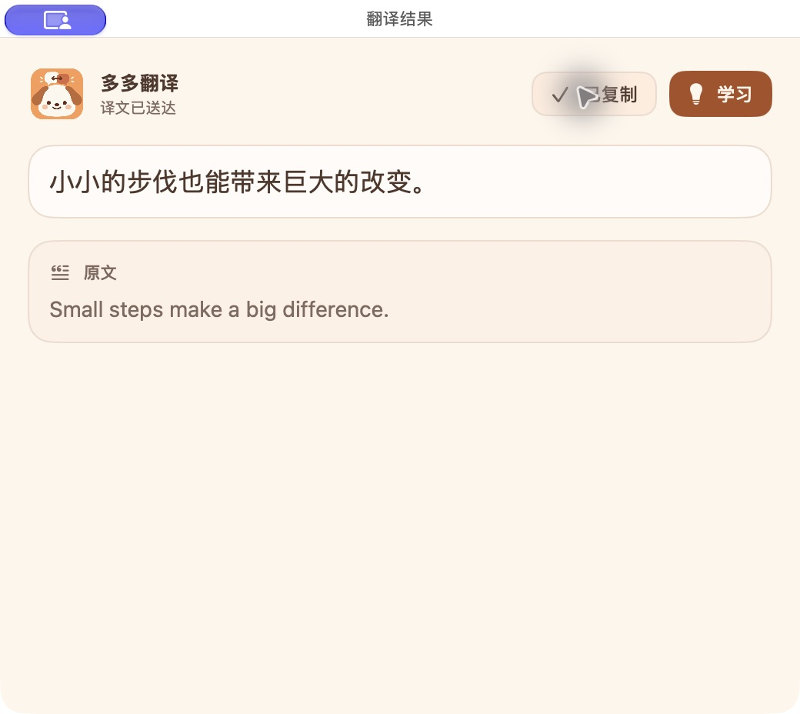
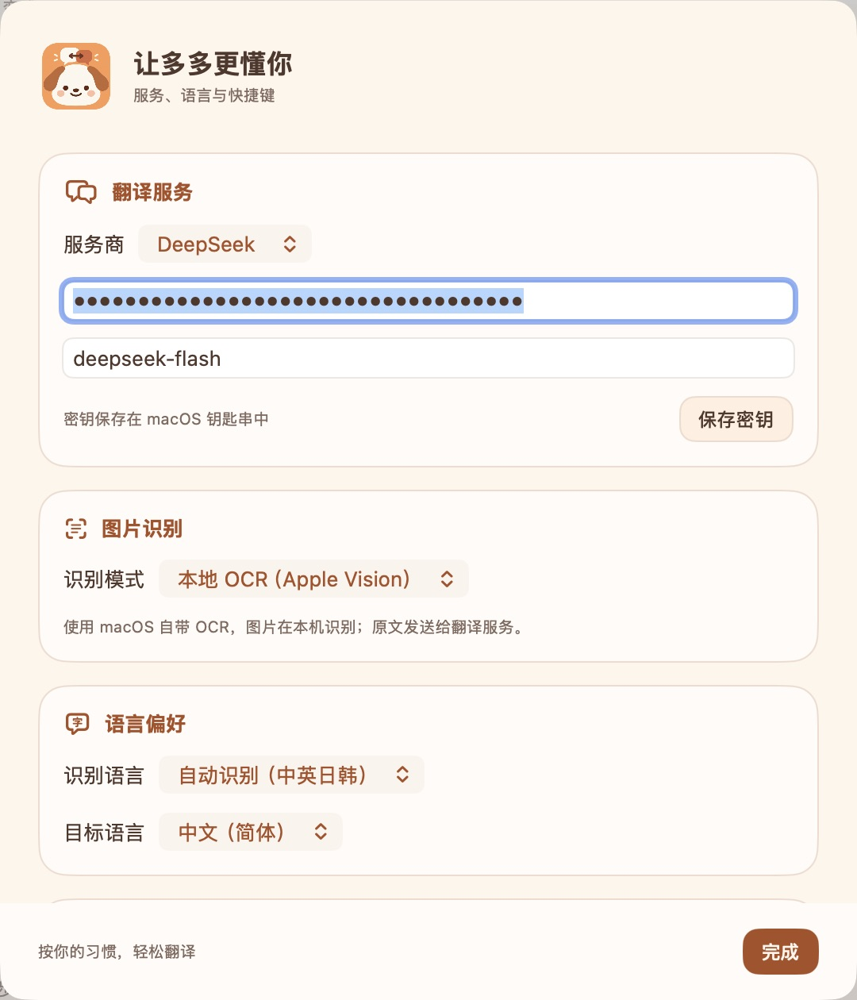
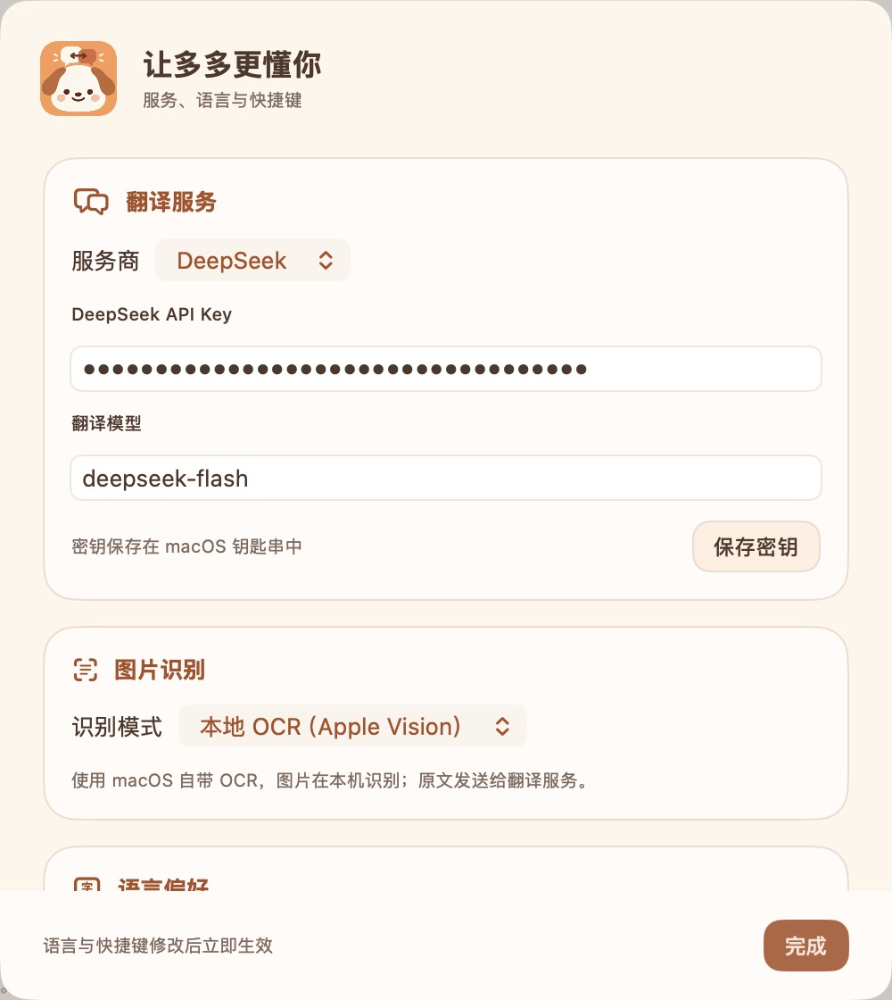

# 多多翻译：三轮审计与优化

日期：2026-10-22。保留开始时已有的图片识别相关未提交修改；本次未提交或推送 Git。

## 可打开的版本

最终应用：[多多翻译.app](../../dist/多多翻译.app)

在访达中双击打开，或执行：

```sh
open /Users/yangchenjie/dev/projects/mac-screen-translator/dist/多多翻译.app
```

应用已经使用本机现有证书完成 Release 构建和签名校验。打包脚本改用 `.build/app`，解决项目移动目录后旧 Swift 模块缓存导致的构建失败。没有安装第三方依赖。

## 五项最重要的改进

1. **截图可靠性与自动识别**：框选期间再次激活应用，只前置框选遮罩，避免主窗口重新出现并被截入图片。多语言 OCR 启用自动语言检测，改善中英混排识别；屏幕录制权限在使用框选时检查，直接输入和剪贴板流程不再受启动权限弹窗打断。
2. **可发现、可完成的翻译流程**：原文卡片新增“翻译原文”，保留 ⌘↩︎；主窗口和结果窗均提供“复制译文”，复制后明确显示“已复制”。空输入按钮禁用，原文显示字数。
3. **原文与结果保持对应**：编辑原文后旧译文标为“待更新”，同时更新状态说明并禁止对错配的原文/译文生成学习笔记。请求期间编辑原文，旧请求不会回写错配结果；失败重试使用当前原文。空模型在本地提示错误，不发送翻译请求。
4. **小屏与表单更易用**：主窗口可缩放并记忆尺寸，正文可滚动；窄窗口将原文和译文上下排列，操作区按可用宽度调整。设置字段持续显示名称，避免值覆盖占位符后失去含义；不自动选中密钥。保存成功有反馈，保存失败保持设置界面并提示原因。
5. **状态与动效反馈**：学习失败显示真实错误和重试入口，避免结果窗一直显示“正在准备”。统一按钮悬停和按压反馈，为复制、处理状态、识别模式展开与学习展开添加短过渡；启用系统“减少动态效果”时关闭新增动画。

## 前后截图

以下均为原生应用实际截图，未用设计稿代替。优化前为启动时已有打包版本，优化后包含本次更改；窗口宽度可因缩放状态不同而不同。

| 页面 | 优化前 | 优化后 |
| --- | --- | --- |
| 主窗口 |  |  |
| 翻译结果 |  |  |
| 设置 |  |  |

其他状态：[半屏布局](after-small-window.png)、[原文修改](after-edited.png)、[翻译错误](after-error.png)、[学习展开](after-learning.png)、[图片识别设置](after-vision-settings.png)、[框选确认](after-selection.png)。框选遮罩的单窗口截图不包含背后的桌面，因此呈现为灰底。

## 实际验证

| 流程或状态 | 结果与范围 |
| --- | --- |
| 直接输入 → 点击翻译 → 结果窗 | 通过；多次使用公开测试英文调用已有 DeepSeek 配置，最终二进制再次通过 |
| ⌘↩︎ 翻译 | 通过；基线阶段实际执行 |
| 剪贴板文字 → 翻译 | 通过；复制测试原文后实际完成 |
| 剪贴板图片 → 本地 OCR → 翻译 | 通过；从预览复制项目自己的截图，识别出测试英文并翻译 |
| 复制译文 | 通过；主窗口/结果窗提供入口，结果窗实际出现“已复制” |
| 学习 → 展开 → 收起 | 通过；最终版本实际返回句意、表达和词汇 |
| 学习失败 | 通过；空模型显示错误和“重试学习”；异步服务失败另有自动测试 |
| 翻译失败 → 设置 → 修正 → 重试 | 通过；空模型失败后恢复原有模型，点击重试并返回真实译文 |
| 编辑原文后的旧结果 | 通过；状态为待翻译，译文待更新，学习内容失效 |
| 框选 → 拖动 → 确认 / Enter | 通过；执行实际屏幕 OCR，修复后返回可读中文，且不再截入自身主窗口 |
| 取消框选 | 通过；Esc 返回主窗口并显示取消状态 |
| 图片识别模式下拉 | 通过；本地/大模型模式与表单展开均实际检查，最终恢复本地模式 |
| 云端识别缺少密钥 | 通过；明确显示缺少识别服务 API Key，切回本地模式后图片流程成功 |
| 设置滚动、日志折叠、快捷键录制 | 通过；展开日志信息、开始录制并用 Esc 取消，不改变原有快捷键 |
| 设置保存成功 | 通过；出现“翻译密钥已保存”，没有修改密钥内容 |
| 半屏窗口 | 通过；原文和译文上下排列，并在小窗口实际完成翻译 |
| 标签页 | 产品没有标签页，属于不适用项 |
| 下拉与模态框 | 使用系统原生交互；检查识别菜单与设置 sheet，保留系统动画 |
| 加载/取消/并发请求 | 加载与取消控件及状态实现检查；取消和旧结果隔离通过可控异步测试；短请求通常在 UI 快照前完成，未测量逐帧动画 |

自动测试：`MAC_TRANSLATOR_LIVE_OCR_TEST=1 swift test --scratch-path .build/audit`，**63 项 XCTest 全部通过，0 失败、0 跳过**，包含英文及中英混排两项真实 Apple Vision 集成测试。[完整输出](test-results.txt)。默认不设置该环境变量时跳过两项真实 OCR 测试。

## 仍未解决或尚未验证的范围

- **指定测试画面的框选翻译端到端复测尚未完成**：原生自动化显示的浏览器单窗口与实际桌面前台不一致，实际截到的是桌面其他内容。已分别验证屏幕 OCR 与公开测试文字翻译；没有把未经确认的桌面内容发送给翻译服务。建议手动在你要翻译的画面上执行一次框选翻译，确认完整链路。
- **云端图片识别成功路径未验证**：没有独立识别服务 API Key。已检查配置、缺钥错误及模拟 HTTP 请求/响应；没有借用翻译密钥或添加新凭据。
- **系统集成边界**：没有完整验证多显示器、全屏 Spaces、实际全局快捷键触发、系统拒绝录屏权限和钥匙串真实写入失败。相关代码或单元测试有覆盖，但不能代替这些实机状态。
- **视觉边界**：当前原生浅色界面与半屏布局已截图检查；深色模式和系统“减少动态效果”仅完成实现检查，没有切换系统设置实测。
- 本地 OCR 对复杂背景、低清晰度或非常规排版仍可能出错，因此保留原文编辑后再翻译的操作。

应用没有移动端版本；本次以小屏、缩放窗口和半屏布局作为对应检查。
