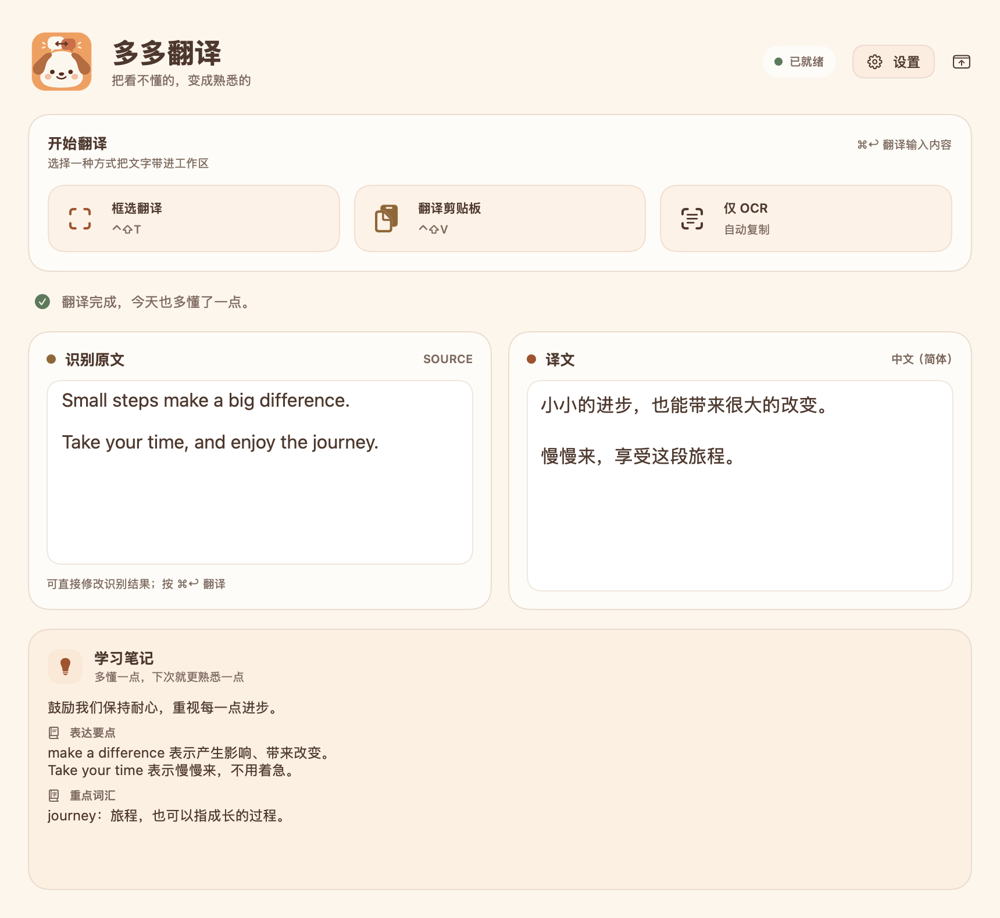

# 与小狗图标配套的暖色界面

更新日期：2026-10-12。

主界面、设置页与悬浮译文窗口统一使用杏桃、奶油与可可色，保留系统明暗模式切换。

## 设计与实现

- 页头直接加载打包后的 AppIcon.png，与 Dock 图标保持一致。
- 三个主要入口采用等宽暖色按钮，按钮有悬停、按下及禁用反馈。
- 原文与译文使用并排圆角卡片，保留原文编辑和译文选中复制。
- 学习笔记放入可滚动区域，按需加载；主界面提供“理解这句话”按钮。
- 设置页分为翻译服务、语言偏好、快捷操作，连接与日志信息放入折叠区域。
- 深色模式采用暖棕底与奶油色文字，主按钮保持清晰对比。

色板与组件位于 Sources/AppTheme.swift；界面位于 Sources/ContentView.swift 与 Sources/TranslationResultPanel.swift。构建脚本在签名前将 AppIcon.png 复制到 bundle。

## 离线界面预览

以下图片使用实际 SwiftUI 视图和虚构示例数据，通过 NSHostingView 离线渲染。预览不读取钥匙串、用户输入或发起翻译请求；不包含窗口标题栏。它们用于验证布局和配色，不代表实际翻译服务的测试结果。

[深色主界面](./design/warm-ui-dark.png) · [浅色设置页](./design/warm-settings-light.png) · [深色设置页](./design/warm-settings-dark.png) · [浅色悬浮译文](./design/warm-result-light.png) · [深色悬浮译文](./design/warm-result-dark.png)

## 验证

20 个既有单元测试通过，Release 构建及签名校验通过，页头图标资源已打包。界面自动化因 Mac 锁定未能进行现场操作验证。退出并重新打开 dist/MacScreenTranslator.app 后加载新界面。
