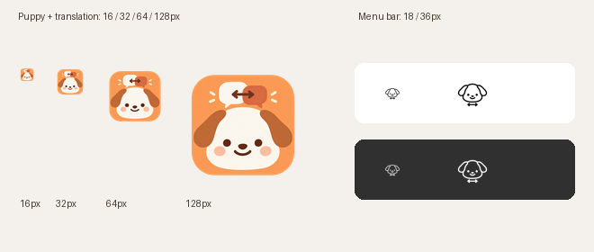

# 色块图标与状态栏图标

更新日期：2026-10-12。使用内置 imagegen 编辑暖色可爱狗狗，加入双对话气泡与双向箭头，表达语言交流和翻译转换。

## 当前设计

- 杏桃色底、奶油色圆脸、焦糖色垂耳、可可色小眼睛和笑嘴，使用大色块提高小尺寸辨识度。
- 不限定犬种，去掉眼镜、博士帽和文字，让表情更轻松。
- App 图标上方加入奶油色、陶土色双对话气泡和双向箭头；状态栏在小狗下方加入双向箭头。
- 状态栏采用圆润狗狗轮廓、小实心眼睛和笑嘴，脸部保持透明，减少大面积黑色填充。
- 状态栏使用 NSImage 模板，由 macOS 根据明暗主题着色；18 与 36 像素资源对应普通及 Retina 屏幕。
- 旧蓝色色块图标和黑色博士帽状态栏源图保存在 `docs/design/icon-history/`。

## 尺寸预览



这是一张离线预览，检查 App 16、32、64、128 像素和状态栏 18、36 像素，未进行现场界面显示验证。

## 文件与使用

- [App 源图](../Packaging/AppIcon.png)，1024 × 1024。
- [App 多尺寸 ICNS](../Packaging/AppIcon.icns)。
- [状态栏透明源图](../Packaging/StatusIcon-source.png)。
- [状态栏 18px](../Packaging/StatusIcon.png) 与 [Retina 36px](../Packaging/StatusIcon@2x.png)。

`Scripts/build-icon.sh` 转换资源，`Scripts/build-app.sh` 将资源复制到 bundle 后重新签名。本次 Release 构建与签名校验通过，运行时资源与源资源一致；只替换图像，没有改变应用逻辑，未重复运行单元测试。

正常退出已有 App，再打开 `dist/MacScreenTranslator.app` 加载新图标。

## 生成提示词

使用内置 imagegen，未调用项目翻译 API。

### App 生成

```text
Use case: logo-brand. Asset type: production macOS app icon for 多多翻译.
Create a very cute friendly puppy icon with bold broad solid color shapes, extremely readable at 32px. A warm soft apricot rounded-square tile with a big creamy ivory puppy face, short rounded floppy caramel ears, two small warm cocoa dot eyes widely spaced, a tiny rounded brown nose, short sweet curved smile and two subtle peach round cheeks. The head is softly rounded and slightly wider than tall, cute calm joyful expression, youthful plush-like proportions but flat graphic style. No breed-specific features. No glasses, no hat, no black face mask, no hollow eye sockets, no sharp shapes. Puppy fills most of the tile, very few details. Warm cream, apricot and caramel palette; cocoa only for tiny facial features. Crisp flat filled shapes, minimal premium app branding, no gradients, no fur, no texture, no 3D or shadows. No text, no letters, no badge, no extra objects. Perfectly smooth rounded-square boundary with equal transparent exterior margins. One square icon only, transparent outside tile.
```

### App 边缘整理编辑

```text
Use case: precise-object-edit. Edit target supplied warm apricot puppy app icon. Preserve its exact cute ivory puppy face, caramel ears, cocoa dot eyes, nose and smiling mouth, peach cheeks, apricot rounded square, proportions and style. Change ONLY exterior transparency and edge cleanup: remove the isolated speck above the tile and any stray colored pixels outside the rounded square. Exterior must be completely transparent, smooth pristine tile boundary, no other changes.
```

### 配套状态栏生成

```text
Use case: logo-brand. Supporting reference: supplied cute warm puppy icon. Create its matching friendly macOS menu-bar icon on transparent background. A rounded puppy face with two short floppy round ears, a simple continuous moderately thick OUTLINE around the head and ears, two tiny SOLID dot eyes, a tiny oval nose and short smiling curved mouth. Large transparent empty face interior, warm happy expression. No filled black head or face mask, no hollow eyes, no cap, no glasses, no text, no cheeks, no tile. One coherent simple cute silhouette drawing. Designed for 18px: about 3px rounded stroke at 36px preview, all lines smooth and round. All visible pixels black for macOS template tinting; all other areas truly transparent including face interior. Big broad rounded curves, no sharp corners, no scary skull shape. One square centered glyph only.
```

### 翻译元素版 App 编辑

```text
Use case: precise-object-edit. Asset type: macOS app icon for 多多翻译.
Edit target: supplied warm apricot cute puppy app icon. Preserve its friendly ivory face, caramel floppy ears, cocoa dot eyes and small smiling mouth, peach cheeks, soft warm palette and broad filled shapes. Add a tasteful SIMPLE TRANSLATION symbol: two compact overlapping rounded speech bubbles ABOVE the puppy, one cream and one muted warm terracotta, with a single bold short two-way horizontal arrow connecting their centers. Bubbles occupy roughly the upper quarter, puppy stays large in lower three quarters. Rebalance only enough to fit symbol comfortably, no tiny clutter, no glasses or hat. Make symbol and puppy visually coherent and easily readable at 32px. No typography: no A, no Chinese characters, no words. Flat solid color blocks, no blue, no black large areas, no texture, no shadows. Apricot rounded-square tile, fully transparent outside. Remove every isolated pixel speck outside tile, perfectly clean smooth edge. One square production icon only, not a mockup.
```

### 翻译元素版状态栏编辑

```text
Use case: precise-object-edit. Edit target: supplied cute puppy outline menu-bar glyph. Preserve friendly rounded floppy ears, head outline, dot eyes, little oval nose and smiling mouth, with transparent face interior. Add one short BOLD horizontal double-headed arrow centered just beneath the puppy chin, to suggest translation in both directions. Rebalance head slightly upward to fit, maintain head as dominant element, arrow roughly half width of head, clear gap. No other symbols or detail. Designed for macOS menu-bar at 18px, sturdy rounded strokes and generous spacing. All visible pixels black with true transparency elsewhere. No white fill, no filled black head, no hollow eyes, no hat, no glasses, no text, no background, no tile. Single square centered simple cheerful icon only.
```
